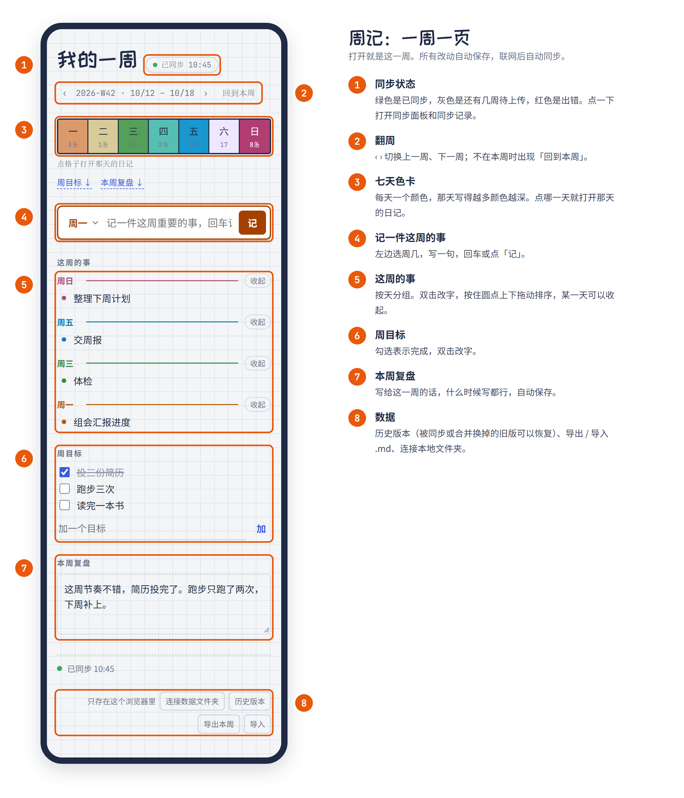
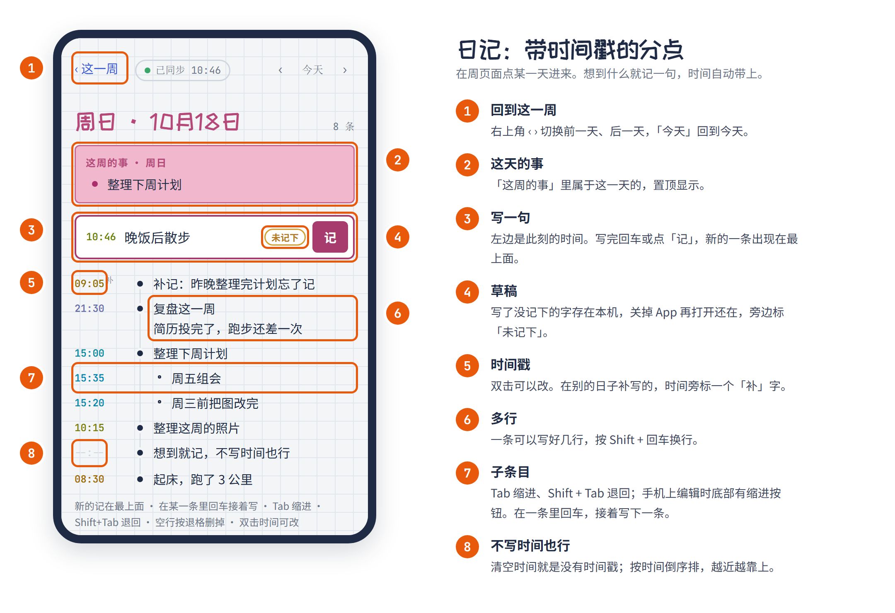

# 我的一周

一个随手记的周手帐。

- **周页面**：七个日期格子是本周的进度条，每格按当天写了多少涂深浅；「这周的事」只标周几，越近的越靠上，每天可以收起；还有周目标和本周复盘。
- **日记页面**：点格子进入当天，分点记录，每条自动带上写下它的时间，时间戳的颜色随钟点渐变；支持缩进、双击改时间、按时间倒序排列。
- **数据是 Markdown**：一周一个 `2026-W42.md`，用任何编辑器都能打开和修改。
- **不用注册也能用**：数据默认只存在你自己的设备上。想多设备同步，可以自己部署一个很小的同步服务。
- **端到端加密（可选）**：同步服务器只存密文，服务器主人也看不到；本地文件还是明文，照常可以改。

所有功能的详细说明见 [docs/FEATURES.md](docs/FEATURES.md)。

## 快速上手

两个页面：**周记**看一整周，**日记**记某一天。在周记里点任意一天的格子进日记，点左上角「‹ 这一周」回来。

### 周记



### 日记



不用点保存：改了什么都会马上存在本机，填了同步服务的话联网后自动同步。图里是示例数据，图的生成方法见 [docs/images/src/render.sh](docs/images/src/render.sh)。

## 怎么用

| 方式 | 适合 | 数据存在哪 |
|---|---|---|
| 安卓 App | 手机上随手记 | 手机里；可以选一个文件夹存 `.md`，也可以连同步服务 |
| 电脑浏览器打开 `web/index.html` | 电脑上用，不想装东西 | 浏览器里；Chrome / Edge 还能直接读写一个本地文件夹里的 `.md` |
| 自己部署同步服务 | 手机和电脑都要用 | 你自己的服务器 `data/` 里，各设备自动同步 |

**安卓 App**：到本仓库的 [Releases](../../releases) 下载 `my-week.apk` 安装。建议在周页面底部点「连接数据文件夹」，选一个文件夹（比如 `文档/我的一周`），日记就会存成那里的 `.md` 文件，卸载 App 也不会丢。不选文件夹的话，数据只存在 App 内部，**卸载会清掉**。

**电脑**：下载仓库（Code → Download ZIP），解压后用 Chrome 或 Edge 打开 `web/index.html`。

## 自己部署同步服务

需要一台装了 Docker 的 Linux 服务器和一个域名。服务本身只用 Python 标准库，占用很小。

```bash
git clone <本仓库地址> my-week && cd my-week
cp -r config.example config && mv config/.env.example config/.env
# 编辑 config/.env，填上 MYWEEK_TOKEN（用 openssl rand -hex 24 生成）
mkdir data                    # 用你自己的身份建，服务会以这个目录主人的身份写文件
docker compose up -d --build  # 只监听 127.0.0.1:8000
```

然后配置 HTTPS，二选一：

- 服务器上已有 Caddy 或 Nginx：加一个站点，把你的域名转发到 `127.0.0.1:8000`。Caddy 的写法见 `config.example/caddy/site.conf.example`。
- 80/443 端口空着：用自带的 Caddy，在 `config/.env` 里填好 `DOMAIN`，再执行 `docker compose --profile standalone up -d --build`，证书会自动申请。

各设备打开页面，在周页面最底下的「同步」里填上服务器地址和令牌。用浏览器打开自己的网址时，服务器地址可以不填，还可以「添加到主屏幕」当 App 用。

**给熟人开账号**：每人一个独立的数据目录，互相看不到。

```bash
./server/adduser.sh alice     # 打印出 alice 的令牌，发给她填进 App
# 想让账号一开始就开启端到端加密：./server/adduser.sh alice --keyid 8位十六进制
# （服务器只收到密钥指纹；密钥和恢复码要在别处生成，见 docs/E2EE-技术笔记.md）
```

名单在 `config/users.txt`，删掉一行就停用；改了不用重启。主人的数据在 `data/`，熟人的在 `data/users/名字/`。每次覆盖前，旧版本会存进那个目录下的 `.history/`。

每个账号可以在「同步」设置里自己开启端到端加密，开了之后服务器上只有密文，做法见 [docs/FEATURES.md](docs/FEATURES.md#端到端加密)。

更新：拉取新代码后执行 `docker compose up -d --build`。

## 构建安卓 App

用 GitHub Actions 构建，电脑上不需要装 Android Studio：

- 在 Actions 页面手动运行「Android APK」，构建完在那次运行的 Artifacts 里下载 APK。
- 推送 `v` 开头的标签（例如 `git tag v0.1.0 && git push --tags`），会构建签名版并发布到 Releases。

签名密钥放在仓库的 Settings → Secrets and variables → Actions 里：`ANDROID_KEYSTORE_BASE64`、`ANDROID_KEYSTORE_PASSWORD`、`ANDROID_KEY_ALIAS`、`ANDROID_KEY_PASSWORD`。没有设置时会构建调试签名的 APK，也能安装，但不能和签名版互相覆盖安装。**同一个密钥签出来的 APK 才能覆盖升级**，密钥要妥善备份。

本地构建（需要 JDK 21 和 Android SDK）：`npm ci && npx cap sync android && cd android && ./gradlew assembleDebug`。

## 目录

```
my-week/
├── web/                  页面（App 和浏览器共用）
│   ├── index.html
│   ├── css/style.css
│   ├── js/dates.js       日期工具、ISO 周号、时间戳配色
│   ├── js/markdown.js    周 ↔ Markdown 的读写
│   ├── js/crypto.js      端到端加密（WebCrypto，AES-256-GCM）
│   ├── js/store.js       本地存储（本机 / 电脑或手机上的文件夹）
│   ├── js/sync.js        和服务器同步
│   ├── js/app.js         页面逻辑
│   ├── sw.js             离线缓存
│   └── manifest.webmanifest, icons/
├── server/
│   ├── app.py            同步服务（只用 Python 标准库）
│   ├── adduser.sh        给熟人开账号
│   └── Dockerfile
├── android/              安卓工程（Capacitor 生成；FolderStorePlugin.java 负责读写用户选的文件夹）
├── docs/FEATURES.md      功能说明
├── config.example/       配置模板，复制成 config/ 使用
├── docker-compose.yml
├── capacitor.config.json, package.json
└── .github/workflows/    自动构建 APK
```

`config/`（令牌、熟人名单、签名密钥）和 `data/`（日记）不进仓库。

## 同步是怎么工作的

- 每台设备在本地都存一份完整的数据，离线时照常写，联网后自动推送。
- 同步时机：每 30 秒一次，切回页面、恢复联网、写完 2 秒后也会触发。
- 服务器给每一周的版本算一个指纹（内容的哈希）。你在服务器上手动改了文件，指纹就变了，设备会把新内容拉下来。
- **冲突**：两台设备改了同一周，后推送的那台会被服务器拒绝覆盖。这时按**条目**三方合并（`web/js/merge.js`，对照「上次对齐的那份、本设备、服务器」三份）。每个条目行尾有一个 ID（见下面的文件格式），靠它认出「同一条」，改了字也认得出：两边各加的条目都留下；一边删了、一边改了字的，改了的留下；一边改字、一边勾选或挪位置的，两样都保留；「同一条被两边改成不同的字」时，**后推送的那台设备为准**，并提示被替换的是哪一条，被替换的那一版存在本机「历史版本」里。不再生成「冲突副本」。
- 令牌错了或连不上服务器时，周页面底部的同步状态会变成红点，并写明原因。
- 开了端到端加密的账号，推上去的是密文，拉下来先在设备上解密；冲突也是解密之后再合并。

## 数据：一周一个 Markdown 文件

每一周存成一个 `.md`，用 ISO 周号命名，例如 `2026-W42.md`。可以直接用任何编辑器改：

```markdown
---
week: 2026-W42
start: 2026-10-12
updated: 2026-10-18T05:40:00.000Z
---

## 周目标
- [ ] 投三份简历 ^k3f9a2
- [x] 设置好周手帐 ^p0xq7m

## 这周的事
### 周一
- 跑完计算 ^b81zte
### 周日
- 定下手帐格式 ^m4c2wd

## 日记
### 10-18 周日
- 11:57 开始画手帐 ^r7n2kq
  - 11:59 决定做网页版
    多行条目的第二行，比圆点多缩进两格 ^w5hj3s
- 10-19 09:00 补记的一条 ^t9gx4e
- 没写时间也可以

## 复盘
自由文本，原样保存。
```

规则：

- 文件开头的 `start`（那周周一）和 `week` 至少要有一个。`updated` 由页面维护，手动改时不用管它。
- 缩进两个空格（或一个 Tab）为一层。缩进跳级会被收回到合理的层数。
- 日记条目以 `HH:MM` 开头；补记的写成 `MM-DD HH:MM`；不写时间就是没有时间戳。
- 「这周的事」用 `### 周一` 到 `### 周日` 分组。
- 四个标题（周目标、这周的事、日记、复盘）之外的 `##` 段落会原样保留在文件末尾。
- 条目行尾的 ` ^k3f9a2` 是条目 ID（Obsidian 的块 ID 写法，在 Obsidian 里可以用 `[[2026-W42#^k3f9a2]]` 引用这一条）。同步合并靠它认出同一条。手写新条目时不用加，页面会补上；改字时别动它。多行的日记条目，ID 在最后一行末尾。

### 存在哪

- **默认**：存在浏览器的 localStorage 里，每周一个键 `myweek:2026-W42`，值就是那周的 Markdown 全文。
- **服务器**：开了同步以后，以服务器上 `data/` 里的文件为准。
- **数据文件夹**：在 Chrome / Edge 桌面版或安卓 App 里点「连接数据文件夹」，每周写成那个文件夹里的 `2026-W42.md`。下次打开会自动恢复连接（电脑上有时需要再点一次授权）。
- **在编辑器里改**：改完切回页面，页面会读入新内容。页面写入前会检查文件的修改时间，如果文件在外面被改过，以文件为准，不会覆盖你的修改。两边别同时编辑同一周就不会有问题。
- **导出 / 导入**：导出当前这一周的 `.md`；导入时可以一次选多个文件，同一周以 `updated` 较新的那份为准。

## 操作

- 日记：回车新起一条，Tab 缩进，Shift+Tab 退回，空行按退格删掉，上下键在各条之间跳。手机上编辑时底部有缩进按钮。
- 时间戳颜色随钟点渐变：凌晨靛蓝 → 清晨玫瑰 → 上午琥珀 → 正午绿 → 下午蓝 → 傍晚紫 → 深夜靛蓝。配色写在 `js/dates.js` 的 `STOPS` 里，每项是 `[小时, 色相, 饱和度系数]`。
- 在过去某天补写的条目，时间戳旁会标一个「补」字。
